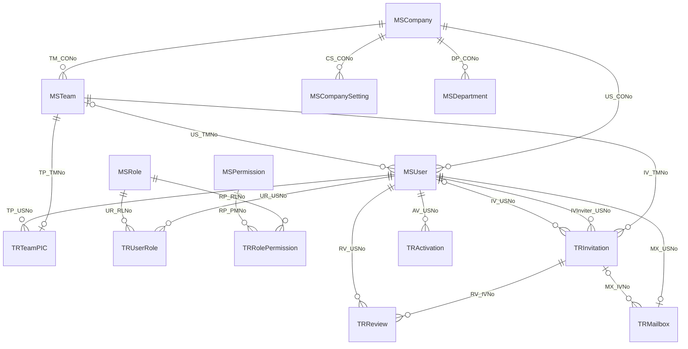

# Foundation database

Status: foundation schema and fictional seed data. The Blade design preview is still configuration-driven. No account, invitation, provisioning, or administration endpoints have been implemented.

## Naming and keys

Use MySQL 8.4 with InnoDB. Foundation application tables use `MS` for master data and `TR` for transactions/associations/history.

For example, `MSTeam` has:

| Column | Meaning |
|---|---|
| `TMID` | Unique auto-increment numeric identifier; not the primary key |
| `TMNo` | String primary key, such as `TM00000001` |
| `TM_CONo` | Foreign key to `MSCompany.CONo` |
| `TMCB` / `TMCD` | Created by `MSUser.USNo` / created timestamp |
| `TMMB` / `TMMD` | Last modified by `MSUser.USNo` / modified timestamp |

References preserve the referenced column name: `TRInvitation.IV_TMNo → MSTeam.TMNo`. When a table refers to two users in different roles, the source-side qualifier explains the role: `IVInviter_USNo` is the inviter; `IV_USNo` is the applicant account if one exists. Audit columns keep the agreed `CB`/`MB` names and reference `USNo`.

Every foundation table, including counters, history, and errors, has prefixed `ID`, `No`, `CB`, `CD`, `MB`, and `MD` columns. A null actor means a system/bootstrap action. Timestamps are stored using the application's configured timezone (currently Laravel's UTC default); the company's display timezone is stored separately. Preserve historical users rather than hard-deleting actors.

Numbers use two letters plus eight digits. `MSNumberSequence` contains one counter row per prefix. Allocation locks that row inside a transaction; it does not use `MAX(No) + 1`. Counter increments roll back with failed writes. Treat numbers as immutable references, not secrets, permission checks, dates, or promises of gapless accounting sequences. The eight-digit range must be expanded before a prefix exceeds 99,999,999.

## Tables and model classes

Models live under `App\Models\Foundation`. Each model explicitly supplies its table, prefix/string primary key, fillable business fields, timestamp mapping, casts, safe audit fields, and relationship methods. Common metadata and actor relationships live in `FoundationModel`.

| Table | Prefix | Model | Main relationships |
|---|---|---|---|
| `MSCompany` | CO | Company | Has teams, users, settings, departments |
| `MSCompanySetting` | CS | CompanySetting | Belongs to company; stores non-secret JSON settings |
| `MSTeam` | TM | Team | Belongs to company; has members, current PIC assignment, invitations |
| `MSUser` | US | User | Belongs to company and optional team; has role/PIC assignments, mailbox, invitations, activations, reviews |
| `TRTeamPIC` | TP | TeamPic | Current team-to-PIC assignment; team and user |
| `MSRole` | RL | Role | Has permission and user assignments |
| `MSPermission` | PM | Permission | Has role assignments |
| `TRUserRole` | UR | UserRole | User and role association |
| `TRRolePermission` | RP | RolePermission | Role and permission association |
| `TRInvitation` | IV | Invitation | Team, inviter, optional applicant account; has reviews and mailbox references |
| `TRReview` | RV | Review | Invitation and reviewer; records a decision and reason |
| `TRMailbox` | MX | Mailbox | One mailbox assignment per user; optional invitation |
| `TRActivation` | AV | Activation | User; expiring, single-use setup token fields |
| `MSDepartment` | DP | Department | Company; separate reference-module data, not a synonym for teams |
| `TRFoundationLog` | FL | FoundationLog | Actor and polymorphic target record |
| `TRFoundationError` | FE | FoundationError | Actor and optional polymorphic target record |
| `MSNumberSequence` | NS | NumberSequence | Internal counters; actor relationships inherited |



History/error target references are polymorphic (`FLTable`/`FLRecordNo`, `FETable`/`FERecordNo`), so a single concrete SQL foreign key cannot cover them. Eloquent's morph map resolves actual table names to model classes. All other application entity references use explicit foreign keys. All actor references use `MSUser.USNo`.

Database constraints enforce unique worker IDs within a company, unique assigned login emails within a company, distinct role/permission assignments, a single current PIC per team, user/team company consistency, and a PIC belonging to the assigned team. Review, mailbox, and account status remain independent fields.

Role grants are seed data, not authorization enforcement. Lifecycle validation, active-PIC checks, review eligibility, invitation duplicates/resends, activation attempt limits, and offboarding rules belong in the later business-rule/API tickets. Lookup tables are used for roles, permissions, and settings; workflow status vocabularies are fixed enum columns so changing a setting cannot invent a new workflow transition.

## Successful writes and failures

Use `FoundationWriter` for application inserts/updates. It owns the outer database transaction. Its `FoundationChanges` object inserts one history row per actual insert/update in that transaction. An unchanged update creates no successful-change row. Multiple related writes can be grouped into one transaction:

```php
use App\Models\Foundation\Team;
use App\Models\Foundation\TeamPic;
use App\Support\Foundation\FoundationChanges;
use App\Support\Foundation\FoundationWriter;

$writer = app(FoundationWriter::class);

// $administrator and $newPic are foundation User records; authorize/validate first.
$writer->transaction($administrator, function (FoundationChanges $changes) use ($team, $newPic) {
    $changes->update($team, ['TMName' => 'Operations & Services']);
    $changes->update($team->picAssignment, ['TP_USNo' => $newPic->USNo]);
});
```

If either update or its history insert fails, all changes and successful history rows roll back. A separate transaction then records one safe error in `TRFoundationError`, and the original exception is rethrown. Failed creates have no durable target number, so their error's record reference remains null. Errors include a correlation UUID, operation, table, exception class, stable code, and a safe summary. They do not include raw exception messages, SQL, query bindings, stack traces, request bodies, passwords, tokens, or provider credentials. If MySQL is unavailable, the normal application log receives a safe correlation/type fallback; an unavailable database cannot record its own failure.

The audit uses per-model field allowlists. Passwords, token hashes, contact/login email values, worker IDs, confidential review reasons, provider references, idempotency keys, and arbitrary company-setting values are excluded from snapshots. Passwords are hashed; token columns are intended for hashes, never raw tokens.

This is an application write gateway, not a database trigger or global exception logger. Future foundation endpoints must call it. Raw SQL, query-builder mass updates, direct `Model::save()`, and external database edits bypass the gateway and must not be used for business writes. Read failures, login failures, and general UI errors are outside this error table's scope. Counters, log/error entries, and migration metadata are internal writes and do not recursively audit themselves. Hard delete is deliberately not exposed; use account deactivation and retain identity/history.

## Existing Laravel tables

Laravel's current `users`, `sessions`, `password_reset_tokens`, `personal_access_tokens`, queue, and cache tables retain their names and columns. The existing `App\Models\User` and auth provider are unchanged. `MSUser` is the foundation user model, not yet the live login provider. Existing user data is not copied, renamed, or removed. Moving authentication to `MSUser` later will require an explicit data migration and string-key compatibility work for sessions/Sanctum; it must not happen implicitly in this schema ticket.

## Migrate and seed

The new migration is additive. It creates only the foundation tables and their counter registry. Never use `migrate:fresh` on an application database with data you need.

```bash
./vendor/bin/sail artisan migrate
./vendor/bin/sail artisan db:seed --class=FoundationSeeder
```

`DatabaseSeeder` now calls `FoundationSeeder`. The seeder refuses to run outside `local`/`testing`. Rerunning it finds existing fixture identities instead of resetting names/statuses or adding duplicate history. Use the fictional `DEMO` company exclusively for these fixtures. Changing a fixture's identifying code manually can cause a new fixture on the next seed.

Seeds include one company, three teams and PICs, an administrator, member lifecycle scenarios, foundation roles/permissions, departments, invitation/review examples, mock mailbox records, activation examples, successful seed history, and one explicitly labelled example error. No provider is connected. No real email is sent. Tokens are null/unusable. Active-looking users have random hashed passwords that are never printed or shared; these are dataset examples, not working demo-login credentials. PIC/bootstrap fixture records do not decide the open production onboarding policy.

## Verification and learning

The integration tests require MySQL and explicitly refuse to reset any database other than `testing`. They use real foreign keys and transactions rather than SQLite approximations.

```bash
./vendor/bin/sail artisan test
```

Coverage includes seed reruns, string-key relationships, transactional rollback, durable safe errors, audit insertion failure, secret exclusion, wrong-team PIC assignment, concurrent number allocation, and reversible foundation migration.

Initial local verification (13 November 2026): the migration and seeder ran successfully on Sail MySQL. All 17 foundation tables have their `No` column as the physical primary key and all six required metadata columns. The initial fixtures contain 10 users, 3 teams, 10 invitations, 89 successful seed-history rows, and 1 clearly labelled example error. Both the existing app and `/design` still return HTTP 200. Eight MySQL foundation tests passed, including 32 concurrent allocations without duplicate numbers.

Learning task: explain why a failed change has no successful audit row, yet its error still exists. Then follow `Invitation::team()` and identify both sides of the foreign key.

References: [Laravel transactions](https://laravel.com/docs/12.x/database#database-transactions), [migration foreign keys](https://laravel.com/docs/12.x/migrations#foreign-key-constraints), [Eloquent model conventions](https://laravel.com/docs/12.x/eloquent#eloquent-model-conventions).
